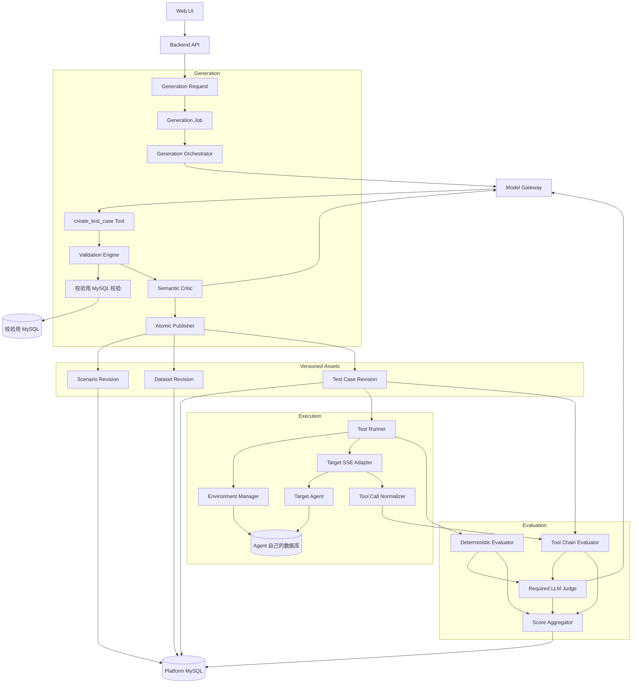
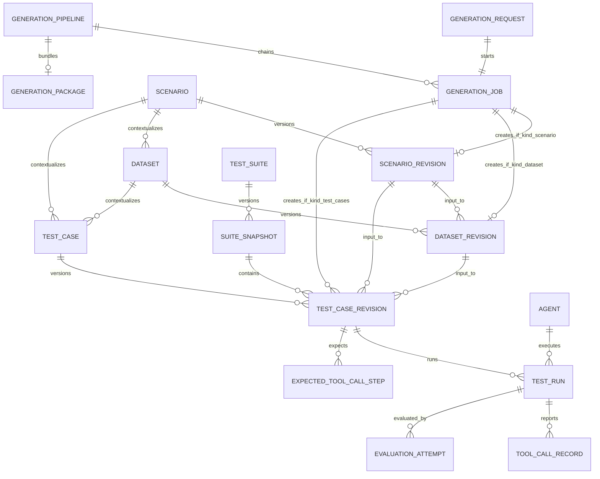
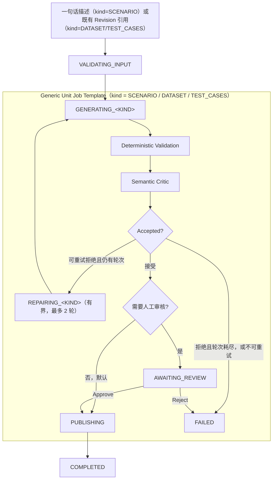
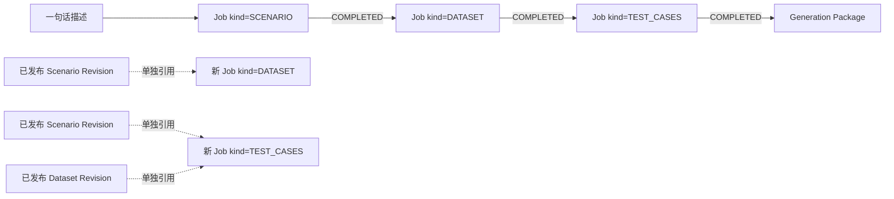
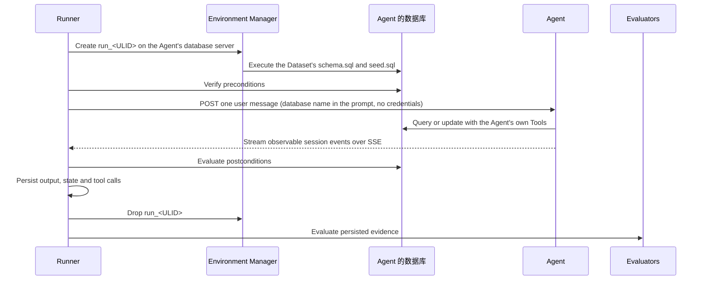

# Agent Testing & Evaluation Platform Architecture

> Version: 1.7
> Date: 2026-09-24
> Status: Ready for MVP Implementation
> Scope: Generation-first MVP

---

# 1. Executive Summary

本平台接收用户的一段简短描述，自动生成完整、可执行的 Agent 测试资产，并完成隔离执行和 LLM 评价。用户不需要手工编写 Business Scenario、MySQL Dataset 或 Test Case。

MVP 的核心闭环是：

```text
One Description
      ↓
AI Generation
      ↓
Deterministic Validation
      ↓
Single-turn Agent Execution
      ↓
Database State Checks
      ↓
Required LLM Evaluation
      ↓
Result and Version Comparison
```

本方案在以下前提下可行：

1. 生成模型支持 Tool Calling 和结构化输出。
2. 平台可以为每次 Test Run 在被测 Agent 自己的数据库服务器上提供隔离的 Run 数据库；平台不创建账号，该服务器的账号由测试人员在 Agent 配置页录入、加密保存，平台只用它写入初始 SQL，不传给 Agent。
3. 目标 Agent 可以在单次请求中接收 MySQL Skill 配置。
4. 目标 Agent API 在最终响应中返回结构化 Tool Call Record。
5. 平台可以调用 OpenAI 或 Ollama，并固定 Model、Prompt 和参数版本。

---

# 2. MVP Scope

## 2.1 In Scope

- 用户提交一次简短描述，AI 自动生成详细测试资产。
- 自动生成 Business Scenario、Business Rules、MySQL Schema、Seed Data 和 Test Case。
- `create_test_case` Tool 统一校验 Test Case 的长度、格式、引用、SQL 和 Oracle。
- Generation Job 内部允许有限次数的 Tool Calling 和自动修复。
- 每个目标 Agent Test 只发送一次用户 Prompt，并接收一次 Final Output。
- 目标 Agent 可在单次请求内部执行多步 MySQL 操作。
- Test Case 包含 Expected Tool Call Chain；Agent API 返回 Actual Tool Call Records。
- Deterministic Matcher 和 LLM Judge 共同评价工具选择、参数、顺序和结果使用。
- 每次 Test Run 使用隔离 MySQL。
- 使用数据库前置条件和后置条件验证任务是否真正完成。
- 每个有效 Test Run 必须经过 LLM Judge。
- 支持不同 Agent 在同一组 Test Case Revision 上比较。

## 2.2 Out of Scope

以下能力不进入 MVP：

- 多轮用户对话和跨请求 Conversation History。
- 平台原生、长期托管的 Knowledge Base 管理与向量检索基准。
- Chain-of-Thought、隐藏推理和任意低层运行日志。
- Test Mutation、Failure-driven Generation 和自动 Regression Case 生成。
- Browser、Email、Voice 等 Agent Surface。
- 对生产数据库的任何访问。

MVP 保存 Agent API 返回的结构化 Tool Call Record，但不保存 Chain-of-Thought。Tool Call 全部来自被测 Agent 自己的返回，标记为 `AGENT_REPORTED`；平台没有 Tool Gateway，只做评价，不代理或验证调用。

被测平台可选的文本 Knowledge API 属于执行兼容面，不是平台原生 KB 产品。Runner 可在 Test
Run 准备阶段上传有 TTL 的文本 Fixture，等待异步索引 `READY` 后把 Document ID 传入一次
SSE Chat；平台不在 MVP 中提供长期知识库编辑、检索或向量管理。

---

# 3. Core Principles

1. **Generation First**：人工审核可以存在，但人工编写不是前置条件。
2. **Single-turn UX**：QA 只提交一次 Generation Request，不通过聊天逐步补齐资产。一次逻辑生成会话可包含多个 LLM HTTP 往返，以完成 Tool Call / Tool Result 闭环。
3. **Tool-gated Persistence**：LLM 不能直接写正式资产，只能调用受控 Tool。
4. **Validate Before Publish**：任何生成内容必须验证后才能进入执行阶段。
5. **Atomic Package**：Scenario、Dataset 和 Test Case 要么一起发布，要么全部不发布。
6. **Immutable Revision**：已验证 Revision 不原地修改，新变化产生新 Revision。
7. **State Before Claims**：任务成功优先依赖可验证状态，而不是 Agent 声称完成。
8. **Structured Tool Evidence**：只保存 Tool 名称、参数、结果摘要、顺序和错误，不保存隐藏推理。
9. **LLM Judge Required**：确定性检查不能替代语义评价，LLM 评价也不能覆盖关键状态失败。
10. **Bounded Resources**：字符、Token、Tool Call、SQL、时间和重试均有硬限制。
11. **Provider Independence**：Generator、Judge 和 Agent 均通过 Adapter 解耦。

---

# 4. User Experience

## 4.1 Single Generation Request

用户输入示例：

```text
为电商客服 Agent 生成订单取消测试。
Agent 可以查询和修改 MySQL。
覆盖已付款未发货、已发货、已取消和“取消最近订单”等含糊请求。
生成 10 个中等到困难案例。
```

可选约束：

- Target Agent
- Domain
- Agent Mode：`ANSWER` 或 `TASK`
- Available Capabilities
- Generate Dataset；关闭时必须选择一个 MySQL Database Profile
- Difficulty Range
- Test Case Count
- Coverage Tags
- Auto Activate

用户不需要先创建 Scenario、Dataset 或 Test Case。

## 4.2 Non-conversational Job UX

点击 Generate 后返回一个异步 Job：

```text
Generation Job: GEN-001
--------------------------------------------------
PASS  Input validation
PASS  Scenario generation
PASS  MySQL dataset validation
RUN   Test case generation and validation  7 / 10
WAIT  Independent critic review
WAIT  Atomic publish
```

Job 页面展示状态、结构化错误和最终资产包；Job 处于 `AWAITING_REVIEW` 时还展示待审核草稿及 Approve/Reject 操作（见 17.1 与 18.7）。Job 页面不提供继续与模型聊天的输入框。用户要改变要求时提交新的 Generation Request。

---

# 5. High-Level Architecture



Generation 和 Execution 使用不同 Worker Pool。大量生成任务不能阻塞 Test Run 的 LLM 评价。

---

# 6. Domain Model



## 6.1 Logical Resource and Revision

逻辑资源提供稳定 ID；Revision 保存不可变内容。Dataset 的逻辑资源必须归属一个 Scenario；Test Case
的逻辑资源必须同时归属一个 Scenario 和一个 Dataset。一个 Scenario 下可以有多个 Dataset；同一个
(Scenario, Dataset) 组合下可以有多个批次的 Test Case（每次 `TEST_CASES` Job 产出一批新的逻辑
Test Case）：

```text
Scenario SC-001
├── SC-001-R1
└── SC-001-R2
      ├── Dataset DS-001（input_scenario_revision = SC-001-R2）
      │     ├── DS-001-R1
      │     └── DS-001-R2
      │           ├── Test Case 批次 A：TC-001..TC-010（input = SC-001-R2 + DS-001-R2）
      │           └── Test Case 批次 B：TC-011..TC-015（input = SC-001-R2 + DS-001-R2）
      └── Dataset DS-002（input_scenario_revision = SC-001-R2）
            └── DS-002-R1
```

Test Run 必须引用 Revision ID，而不是只引用逻辑 ID。

## 6.2 Generation Job Kind and Precondition

一个 Generation Job 只生成**一种**产物（`job_kind`），不再总是一次性产出整套
Scenario+Dataset+Test Case：

| `job_kind` | 产物 | 必需输入（Precondition） |
|---|---|---|
| `SCENARIO` | 1 个新的 Scenario Revision（新逻辑 Scenario，或既有 Scenario 的新 Revision） | 无，直接来自用户原始描述 |
| `DATASET` | 1 个新的 Dataset Revision（新建或既有逻辑 Dataset 下的新 Revision） | `input_scenario_revision_id`，且必须是 `ACTIVE` 或 `VALIDATED` |
| `TEST_CASES` | `request.test_case_count` 个新的逻辑 Test Case 及其 Revision | `input_scenario_revision_id` 和 `input_dataset_revision_id`，且都必须是 `ACTIVE` 或 `VALIDATED` |

三种 `job_kind` 共用同一个状态机模板（见 15.1）：把模板里的 `GENERATING_<KIND>` /
`VALIDATING_<KIND>` / `REPAIRING_<KIND>` 换成 `SCENARIO`、`DATASET` 或 `TEST_CASES` 即可。每个
Job 各自独立做 Atomic Publish（只覆盖自己的产物），不再要求 Scenario+Dataset+Test Case 三者一次性
一起可见——这是支持下面“自由组合”的必要前提。

## 6.3 Generation Pipeline（组合与复用）

`Generation Pipeline` 是“从一句话描述生成完整资产包”的便捷编排：提交一个描述后，平台依次创建并
串联三个 Job，前一个 `COMPLETED` 才创建下一个：

```text
Pipeline
├── Job 1  kind=SCENARIO
├── Job 2  kind=DATASET     input_scenario_revision_id = Job 1 已发布的 Scenario Revision
└── Job 3  kind=TEST_CASES  input = Job 1 + Job 2 已发布的 Revision
```

Pipeline 中任意一个 Job 变为 `FAILED`，Pipeline 整体标记 `FAILED`；已经发布的上游产物（例如 Job 1
的 Scenario）不回滚，它已经是独立、原子发布的合法资产，可以被其他 Pipeline 或 Job 继续引用。

Pipeline 不是唯一入口。任何已发布（`ACTIVE`/`VALIDATED`）的 Scenario 或 Dataset Revision 都可以被
直接引用，单独提交一个 `pipeline_id` 为空的 `DATASET` 或 `TEST_CASES` Job，从而：

- 在同一个 Scenario 下生成多个不同的 Dataset（例如覆盖不同数据规模或边界情况）。
- 在同一个 (Scenario, Dataset) 下多次生成新的 Test Case 批次（例如后续追加更多难度或覆盖标签）。

`Generation Package` 在一次 Pipeline 的三个 Job 全部 `COMPLETED` 后生成，作为该次完整链路的清单/
回顾视图，不再是发布的必要条件；Generation Manifest 至少记录：

- 原始请求摘要和 Request Config
- Generator、Critic 的 Model Version
- 各阶段 Prompt Version
- `create_test_case` Tool Schema Version
- Tokenizer Version
- 模型参数和 Random Seed（Provider 支持时）
- Artifact SHA-256

---

# 7. Generation Request and Limits

## 7.1 Request Contract

```json
{
  "description": "为电商客服 Agent 生成订单取消测试，需要覆盖已付款和已发货订单。",
  "target_agent_id": "01K4Z6Y7X8W9V0T1S2R3Q4P5N6",
  "generate_dataset": true,
  "domain": "e-commerce",
  "agent_mode": "TASK",
  "capabilities": [
    "MYSQL_QUERY",
    "MYSQL_EXECUTE",
    "ORDER_MANAGEMENT"
  ],
  "difficulty": {
    "min": "MEDIUM",
    "max": "HARD"
  },
  "test_case_count": 10,
  "coverage": [
    "NORMAL",
    "EDGE_CASE",
    "AMBIGUOUS"
  ],
  "auto_activate": true,
  "require_manual_review": false
}
```

只有 `description` 必填。`require_manual_review` 默认 `false`；为 `true` 时，Pipeline 中每个 Job 在发布前
都会暂停在 `AWAITING_REVIEW`，等待 `POST /generation-jobs/{id}/review`（见 17.1），后续链式 Job 继承该设置。
`generate_dataset` 默认 `true`。当其为 `false` 时，
`database_profile_id` 必填：平台使用只读凭据采集 validation MySQL 中配置的业务参考 Schema/Fixture，
创建不可变 Dataset Revision，并在 validation MySQL 内为该 Dataset 新建一次性执行 Schema 后加载；
Test Run 永远不直接修改参考 Schema。
未提供的业务字段由系统默认值和 AI 推导补齐。快照路径（`generate_dataset=false`）的 `schema_sql`/`seed_sql` 来自参考库的只读快照，不由模型生成；`constraints`、`difficulty_profile`、`coverage_tags` 仍由 AI 推导，并且只通过同一个 Dataset 生成调用返回。模型只能看到表、列和键结构，看不到任何行数据。Dataset 阶段的 Semantic Critic 不在提示中接收行数据，而是通过 `read_dataset_rows` 分页读取（见 9.1）。快照的行是虚拟测试数据，只发送给平台为生成与评审配置的模型（第三方 API 或 Ollama），不进入被测 Agent 的任何提示。

## 7.2 Default Hard Limits

| Item | Default |
|---|---:|
| Description characters | 4,000 |
| Description tokens | 1,500 |
| Test cases per job | 1-20 |
| Test prompt characters | 4,000 |
| Test prompt tokens | 1,500 |
| Expected output characters | 8,000 |
| One validation SQL | 4,096 characters |
| Tool payload | 256 KB |
| LLM invocations per job | 8 |
| Tool calls per generation round | 20 |
| Automatic repair rounds | 2 |
| Generation job duration | 10 minutes from the first advance past acceptance, including time waiting in AWAITING_REVIEW |

字符限制用于快速拒绝异常输入；Token 限制优先使用目标模型对应的 Tokenizer 在服务端精确计算。模型不提供可用 Tokenizer 时，只允许使用版本化的保守估算器并缩小 Effective Context Window。客户端计数只用于提示。

超限返回明确错误，例如：

```json
{
  "code": "INPUT_TOKEN_LIMIT_EXCEEDED",
  "actual": 1821,
  "limit": 1500,
  "retryable": false
}
```

平台不得静默截断用户描述、Test Prompt、SQL 或 Expected Output。

---

# 8. Context Budget Management

## 8.1 LLM Compatibility Decision

MVP 在 Go Backend 内实现 Provider-neutral `ModelGateway`，不把 OpenAI 或 Ollama 的原始类型泄露到 Generation 和 Evaluation Domain。

Provider Adapter 采用以下共同协议子集：

```text
POST /v1/chat/completions
messages
tools / tool_choice
assistant.tool_calls
response_format: json_schema（模型支持时）
usage（Provider 返回时）
```

OpenAI 和 Ollama 分别配置独立 Adapter、Base URL、Credential 和 Capability Profile。Ollama 提供 OpenAI-compatible `/v1/chat/completions`，但具体模型是否可靠支持 Tool Calling、Parallel Tool Calls 和 Structured Output 必须通过 Model Registry 声明并在启动时执行 Capability Probe。

MVP 使用非流式响应，不使用 OpenAI Responses API 的 Provider-specific 功能。模型不支持原生 JSON Schema 时，可通过强制 Tool Calling 获得结构化结果；既不支持 Tool Calling 也不支持 JSON Schema 的模型不能承担 Generator、Critic 或 Judge Role。

[LiteLLM](https://github.com/BerriAI/litellm) 可以作为可选的 OpenAI-compatible Proxy 接入同一 Adapter，但不作为 MVP 必需组件。当前只有 OpenAI 和 Ollama 两个 Provider，直接 Adapter 更少一个 Python 服务、配置层和故障点。

## 8.2 Model Registry

Model Registry 为每个模型维护：

```text
provider
model_id
model_version
context_window
max_output_tokens
tokenizer_id
supports_tool_calling
supports_json_schema
supports_parallel_tool_calls
supports_usage
max_tool_calls
```

同一个 Generation Job 或 Evaluation Attempt 不在失败后静默切换 Provider。若启用 Fallback，必须创建新的 Attempt 并记录实际 Provider、Model、Capability Profile 和失败原因。

## 8.3 Budget Formula

每次模型调用必须在发起前满足：

$$
T_{system} + T_{tools} + T_{user} + T_{artifacts} + T_{errors}
+ T_{reserved\_output} + T_{margin} \le T_{context}
$$

约束：

- `T_reserved_output` 在请求前预留，不能把整个窗口都用于输入。
- `T_margin` 默认是 Context Window 的 5%，且不低于平台绝对下限。
- 每个生成阶段重新构造上下文，不沿用完整 Message History。
- Dataset 阶段之后只传 Dataset Catalog、相关 DDL 和必要样例，不重复传完整 Seed SQL。
- Repair 只传失败字段、错误码和必要的 Schema Catalog。

预算不足时按以下顺序处理：

1. 删除与当前 Test Case 无关的表摘要和样例。
2. 将 Validator Error 压缩为结构化字段路径与错误码。
3. 将一个生成批次拆成多个独立批次。
4. 仍超限则以 `CONTEXT_BUDGET_EXCEEDED` 结束 Job。

内部 Tool Calling 可能产生多个模型 API 往返，但对用户仍是一次 Generation Request。这些往返受 Job 调用次数、Token 和时间上限控制。

## 8.4 Internal Session Compaction

单轮用户请求不等于单次模型调用。Generation 阶段内的 assistant Tool Call 和 Tool
Result 会形成短生命周期内部 Session；较大的 SQL、校验错误或 Tool Result 可能使后续
模型调用超出 Context Window。每次 Provider 请求前，Orchestrator 必须先估算完整输入，
预算不足时执行 Session Compaction，而不是截断字符串或丢弃消息。

Compaction 规则：

1. System Prompt、原始 Stage Task、当前 Artifact 摘要和尚未完成的 Tool Call 不可压缩；
  最近 `KeepRecentGroups` 个完整 Tool 交互组原样保留。只有某组单独加上基础请求（不含其他组和压缩记录）
  就超出预算、且已有安全语义摘要时，才允许压缩它；否则按从旧到新压缩其他完整组。
2. assistant Tool Call 与其全部 Tool Result 是不可拆分的交互组，只能整体保留或整体压缩。
3. Tool 执行器为大结果同时产生有界语义摘要；压缩记录保留 Call ID、Tool Name、参数摘要、
  结果摘要、状态、原始字节数和语义摘要。没有安全摘要的大结果不得静默截断，必须返回
  `CONTEXT_BUDGET_EXCEEDED`。
4. 已接受 Artifact ID/Digest、剩余目标、Validator Error Code 和 Repair Round 来自平台状态
  Ledger，不依赖模型自行回忆。模型生成的摘要不能成为验证或发布证据。
5. Compaction 后重新计算预算；仍超限时继续压缩更早的完整交互组，最后仍不足则失败 Job。
6. Compaction Report 记录压缩前后 token 估算、消息范围和 source digest，按 Generation Draft
  的 24 小时策略保留。完整 Tool Evidence 独立保存；不保存 Chain-of-Thought 或隐藏推理。
7. 压缩记录只原样保留最近 `MaxRetainedRecords` 条，更旧的记录按序折叠进一个有界的 Rollup（平台状态
  Ledger 锚点）：`folded_groups`、按序覆盖全部被折叠 source digest 的 `chain_digest`、首尾 Call ID，
  以及调用方提供的确定性类型化状态（Dataset Critic 为各表已读取的行范围）。Rollup 超过
  `MaxRollupBytes`、或状态折叠失败，以 `CONTEXT_BUDGET_EXCEEDED` 失败，不截断。因此无论一个 Session
  完成多少个 Tool 组，压缩后的信封大小都以 `MaxRollupBytes` 加上 `MaxRetainedRecords` 条记录为界。

同一 Session 最多执行配置化次数的压缩，且压缩本身不重置 Job 的 LLM 调用、Token 或时间预算。

---

# 9. Generation Pipeline

每个 Generation Job 只跑一种产物（`job_kind`），但三种产物共用同一个状态机模板：生成草稿、
确定性校验、语义 Critic（合并在同一个 `VALIDATING_<KIND>` 阶段内先后进行，见 9.1）、必要时有界
修复、可选人工审核，最后原子发布。



Pipeline 把三个 Unit Job 串起来（描述见 6.3）：



## 9.1 Stage Responsibilities

Deterministic Validation 和 Semantic Critic 属于同一个 `VALIDATING_<KIND>` 阶段，不再有独立的
`CRITIC_REVIEW` Job 状态：先跑确定性检查，只有确定性检查通过才跑 Critic；两者中任意一个失败都
产生统一的 Accept/Reject 决定，走同一个 Repair-或-Fail 分支（见 9.2 之后的 Repair 小节和
`03-generation-and-validation.md` 第 8 节）。Critic 的结论永远不能绕过或覆盖确定性检查结果。

### Scenario Generator / Validator（`job_kind=SCENARIO`）

生成：Domain、Name、Description、Required Capabilities、Business Rules
（`SOURCE_REQUIREMENT`/`GENERATED_ASSUMPTION`）、Difficulty Profile、Coverage Plan。

- Deterministic：JSON Schema、请求约束保真（Domain/Capabilities/Coverage/Difficulty 未被生成结果
  丢弃或篡改）、Business Rule ID 唯一且 provenance 合法。
- Semantic Critic（单 Scenario 范围）：Business Rule 是否自洽、Coverage Plan 是否貌似可执行、是否
  有被标为 Assumption 但明显是硬性需求的规则。

### Dataset Generator / Validator（`job_kind=DATASET`，输入 `input_scenario_revision_id`）

生成：`schema.sql`、`seed.sql`、`constraints.json`、`metadata.json`。

- Deterministic：MySQL AST 校验、在 validation MySQL 实际建库执行、`AFTER_SEED` 约束检查。
- Semantic Critic（Scenario + Dataset 两方范围）：Dataset 是否覆盖 Scenario 所需的业务概念/表；
  是否有 Scenario 暗示但 Dataset 缺失的关键实体或状态。行数据不进入提示：Critic 通过
  `read_dataset_rows`（`table`、`offset`、`limit`；`limit` 默认 50，最多 200）按主键顺序分页读取执行
  Schema 中的行，每页至多 4 KiB（单行超过时仍返回该行），以 `next_offset` 续读。每次评审的读取预算为
  16 次；耗尽后返回 `READ_BUDGET_EXHAUSTED`，Critic 必须提交结论。结论只能通过 `submit_critic_review`
  提交（参数即 Critic 结果 Schema，经契约校验；未通过则返回 `REVIEW_INVALID` 要求修正），Tool Choice
  为 Required。Provenance 记录各表已读取的行范围、模型调用与工具调用次数。

### Test Case Generator / Validator（`job_kind=TEST_CASES`，输入 `input_scenario_revision_id` 和
`input_dataset_revision_id`）

只允许通过 `create_test_case` Tool 提交 Test Case，不能直接写数据库；每次 Tool 调用立即跑确定性
Tool Validator。累计 Accepted 数量等于 `request.test_case_count` 后，进入
`VALIDATING_TEST_CASES` 做整批复核。

- Deterministic：JSON Schema、引用范围、SQL AST/Precondition 执行、Mutation Scope、Tool Chain
  编译、去重指纹——这些已经在每次 `create_test_case` 调用时逐条做过；`VALIDATING_TEST_CASES` 只需
  确认累计数量与去重后的整批状态。
- Semantic Critic（Scenario + Dataset + 全部 Test Case 三方范围，即“检查 Scenario、Dataset、
  Prompt 和 Oracle 是否语义一致”的完整版本）：
  - Test Case 是否覆盖请求中的重点（`coverage.requested` vs `coverage.covered`）。
  - 是否存在大量只替换 ID 的重复案例。
  - 推导出的业务规则是否明确记录为 Assumption。

  Critic 输出用 `case_findings`（定位到具体 `client_case_id`，复用按用例 Repair 机制）或
  `package_findings`（没有具体用例，例如“Coverage 不足”，触发整批重新生成）区分问题范围。

条件允许时，Critic 使用与 Generator 不同的模型；至少必须使用独立 Prompt Role。

## 9.2 Oracle Independence

同一个 LLM 同时生成数据和 Expected Result 容易形成“内部自洽但业务错误”的 Oracle。MVP 采用以下缓解措施：

1. 用户明确给出的规则标记为 `SOURCE_REQUIREMENT`。
2. AI 推导的规则标记为 `GENERATED_ASSUMPTION` 并在 UI 展示。
3. SQL 和数据库状态由确定性执行验证。
4. 独立 Critic 评审业务语义与覆盖。
5. 可选人工审核插入在 `AWAITING_REVIEW`（发布前，`require_manual_review=true` 时生效，默认
   关闭）：Job 暂停等待人工 Approve/Reject，不作为生成过程本身的前置条件。

平台不能把纯 AI 推导的 Assumption 宣称为企业真实业务规则。

---

# 10. create_test_case Tool

## 10.1 Purpose

`create_test_case` 是生成内容进入 Staging Area 的唯一入口。Tool 不直接发布正式资产；所有 Test Case 通过后由 Publisher 原子提交整个 Package。

## 10.2 Tool Input

```json
{
  "job_id": "GEN-001",
  "client_case_id": "cancel-paid-order",
  "scenario_revision_id": "SC-DRAFT-001",
  "dataset_revision_id": "DS-DRAFT-001",
  "agent_mode": "TASK",
  "prompt": "Please cancel order O10001.",
  "preconditions": [
    {
      "query": "SELECT status FROM orders WHERE id = 'O10001'",
      "expected": [["PAID"]]
    }
  ],
  "expected_output": {
    "type": "SEMANTIC",
    "value": "The response confirms that O10001 was cancelled."
  },
  "postconditions": [
    {
      "query": "SELECT status FROM orders WHERE id = 'O10001'",
      "expected": [["CANCELLED"]],
      "critical": true
    }
  ],
  "allowed_state_changes": [
    {
      "table": "orders",
      "operation": "UPDATE",
      "columns": ["status", "updated_at"],
      "predicate": {
        "column": "id",
        "operator": "=",
        "value": "O10001"
      },
      "min_affected_rows": 1,
      "max_affected_rows": 1
    }
  ],
  "expected_tool_call_chain": {
    "match_mode": "ORDERED_SUBSEQUENCE",
    "allow_extra_read_calls": true,
    "max_actual_calls": 6,
    "steps": [
      {
        "id": "lookup-order",
        "tool_name": "mysql.query",
        "required": true,
        "critical": true,
        "intent": "Read the target order before cancellation.",
        "sql_match": {
          "operation": "SELECT",
          "required_tables": ["orders"],
          "required_columns": ["id", "status"],
          "required_predicates": [
            {"column": "id", "operator": "=", "value": "O10001"}
          ]
        }
      },
      {
        "id": "cancel-order",
        "tool_name": "mysql.execute",
        "required": true,
        "critical": true,
        "intent": "Set only O10001 to CANCELLED.",
        "sql_match": {
          "operation": "UPDATE",
          "required_tables": ["orders"],
          "required_assignments": [
            {"column": "status", "value": "CANCELLED"}
          ],
          "required_predicates": [
            {"column": "id", "operator": "=", "value": "O10001"}
          ]
        },
        "result_match": {
          "status": "SUCCESS",
          "affected_rows": {"min": 1, "max": 1}
        }
      }
    ],
    "forbidden": [
      {
        "tool_name": "mysql.execute",
        "sql_match": {
          "forbidden_tables": ["customer", "payment", "shipment"]
        }
      }
    ]
  },
  "evaluation_criteria": [
    {
      "name": "correctness",
      "description": "The answer identifies the correct order and outcome.",
      "weight": 0.6
    },
    {
      "name": "completeness",
      "description": "The answer contains the information needed by the user.",
      "weight": 0.4
    }
  ],
  "difficulty": "MEDIUM",
  "difficulty_profile": {
    "data_complexity": 2,
    "reasoning_complexity": 3,
    "tool_complexity": 3,
    "ambiguity": 1,
    "multi_step": 3,
    "state_change_complexity": 3,
    "adversarial_complexity": 1
  },
  "generation_assumptions": [
    "Paid but unshipped orders may be cancelled."
  ]
}
```

## 10.3 Validation Order

Tool 按固定顺序校验：

1. **JSON Schema**：必填字段、类型、枚举、数组大小，拒绝未知字段。
2. **Length and Token**：Prompt、Expected Output、SQL 和 Payload 不得超限。
3. **Reference**：Job 和 Draft Revision 必须存在且属于同一 Staging Area。
4. **SQL AST**：Pre/Post Condition 只允许一条只读 `SELECT`。
5. **SQL Safety**：禁止多语句、用户变量、存储过程、跨库引用和危险函数。
6. **SQL Execution**：在 validation MySQL 的执行 Schema 中执行 Precondition，结果必须与 Expected 匹配。
7. **Result Shape**：Expected 必须能按列、行、`NULL`、数字和时间规则规范化。
8. **Oracle**：写任务至少包含一个 `critical=true` 的 Post Condition。
9. **Mutation Scope**：所有写操作都必须被 `allowed_state_changes` 覆盖，并限制表、列、行和数量。
10. **Tool Chain**：Step ID 唯一，Tool 已注册，SQL Matcher 可解析，关键写任务至少有一个 Critical Tool Step。
11. **Evaluation**：Criteria 名称唯一，权重和在 $10^{-6}$ 容差内等于 1。
12. **Consistency**：Prompt 中关键实体存在于 Dataset，能力和 Scenario 匹配。
13. **Duplicate**：`client_case_id`、Prompt Fingerprint 和 Oracle Fingerprint 不重复。

如果查询可能返回多行，必须包含确定性的 `ORDER BY`，否则 Validator 拒绝该 Test Case。

## 10.4 Tool Chain Matching

MVP 只支持 `ORDERED_SUBSEQUENCE`：Required Step 必须依次匹配 Actual Tool Call，但允许在相邻 Required Step 之间出现额外只读调用。写调用不能作为未列出的额外调用。

SQL 不按字符串比较。平台将 SQL 解析成规范化 AST，再比较 Operation、Table、Column、Predicate 和 Assignment。表别名、空白、大小写和等价的参数占位符不影响匹配；不在 Matcher 支持范围内的复杂表达式由 LLM Judge 评价，但不能绕过 Mutation Scope 和 Forbidden Call 硬门槛。

确定性 Tool Chain Hard Failure 包括：

- 缺少 `critical=true` 的 Required Step。
- 调用 Forbidden Tool 或命中 Forbidden SQL Matcher。
- 写调用超出 `allowed_state_changes`。
- Tool Call 数超过 `max_actual_calls`。
- Required 写调用返回 Error 或影响行数越界。

## 10.5 Tool Result

失败：

```json
{
  "accepted": false,
  "errors": [
    {
      "code": "SQL_STATEMENT_NOT_ALLOWED",
      "path": "postconditions[0].query",
      "message": "Only one read-only SELECT statement is allowed.",
      "retryable": true
    }
  ],
  "remaining_repair_rounds": 1
}
```

成功：

```json
{
  "accepted": true,
  "draft_test_case_id": "TC-DRAFT-001",
  "content_digest": "sha256:..."
}
```

Tool 使用 `(job_id, client_case_id)` 作为幂等键。Worker 或模型重试不能重复创建。

## 10.6 Repair Boundary

以下错误可进入有限修复：

- Schema 字段缺失或格式错误。
- SQL 列名错误或查询不确定。
- Criteria 权重错误。
- Prompt 与 Dataset 实体不一致。

以下错误立即终止 Job：

- Job 或 Draft Revision 不存在。
- Context Budget、时间或调用次数已耗尽。
- validation MySQL 基础设施失败。
- Payload 超过安全上限。

---

# 11. MySQL Dataset Design

## 11.1 Artifact Structure

```text
Dataset Revision
├── schema.sql
├── seed.sql
├── constraints.json
└── metadata.json
```

`metadata.json` 至少包含：

- Table、Column 和关系摘要
- Row Count
- Fixed Clock、Timezone、Charset、Collation 和 SQL Mode
- Difficulty Profile
- Scenario Coverage Tags
- Artifact Digest

## 11.2 SQL Allowlist

| Artifact | Allowed | Forbidden Examples |
|---|---|---|
| `schema.sql` | `CREATE TABLE`, `CREATE INDEX` | User management, plugin, event, file operation, cross-database object |
| `seed.sql` | Explicit-column `INSERT` | `LOAD DATA`, procedure, trigger, dynamic SQL |
| Pre/Post Condition | One read-only `SELECT` | DML, DDL, multi-statement, cross-database query |
| Agent `mysql.query` | Read-only query | DML and DDL |
| Agent `mysql.execute` | Business-table DML | DDL, user management, cross-database access |

SQL 必须使用 MySQL Dialect AST Parser，不能使用正则表达式判断安全性。

## 11.3 Dataset Validation

```text
Generated SQL
    ↓
AST and Allowlist
    ↓
Fresh validation MySQL Validation Schema
    ↓
Execute schema.sql
    ↓
Execute seed.sql
    ↓
Relational Constraints
    ↓
Business Constraints
    ↓
Scenario Consistency
    ↓
Dataset Catalog and Digest
```

默认资源限制：

- 最大 20 张表。
- 最大 10,000 行 Seed Data。
- 单条 SQL 和总 SQL Script 大小限制。
- 单语句与总执行时间限制。
- 禁止非确定性的 `RAND()`、`UUID()`、`NOW()`，除非使用固定 Seed 或 Clock。

## 11.4 Run Isolation

每个 Test Run 使用独立 Database，建在**被测 Agent 自己配置的数据库服务器**上（Agent 的 `database_profile_id`，17.2）：

```text
RUN-001 -> run_<RUN-001 ULID>
RUN-002 -> run_<RUN-002 ULID>
```

Run 开始时，平台用 Agent 配置的账号连接该服务器，创建 `run_<ULID>`，并**原样执行 Dataset Revision 自带的 `schema_sql` 和 `seed_sql`**（初始 SQL）。数据不经过平台数据库导出再导入，因此没有跨引擎兼容问题。平台不向被测 Agent 传递任何数据库凭证，只在提示词里告知库名，Agent 用自带的 Tool 访问自己的数据库。

- Agent 没有配置数据库时，`POST /test-runs` 返回 `409 AGENT_DATABASE_NOT_CONFIGURED`，不排队。
- 创建 Agent 时平台会做连通性检查：用该账号连接、创建并写入一个 `atp_probe_*` 临时库后删除；失败返回 `400 AGENT_DATABASE_CHECK_FAILED`，原因随响应给出。
- Run 结束后 `run_<ULID>` 在 `finally` 语义下删除。Worker 异常退出留下的残库由 Worker 每 10 分钟的清理任务删除：只删对应 Run 已结束（非 QUEUED、PREPARING、RUNNING）的库，不动进行中的、平台不认识的和命名不符的库。
- Environment Manager 使用 Lease 和 Heartbeat 防止同一 Run 被并发执行。

校验用 MySQL（16.5）只在**生成** Dataset 时用来执行并校验 SQL，不参与 Run。

---

# 12. Test Case Model

```json
{
  "id": "TC-001",
  "revision_id": "TC-001-R1",
  "scenario_revision_id": "SC-001-R1",
  "dataset_revision_id": "DS-001-R1",
  "agent_mode": "TASK",
  "prompt": "Please cancel order O10001.",
  "preconditions": [],
  "expected_output": {
    "type": "SEMANTIC",
    "value": "The order was cancelled."
  },
  "postconditions": [],
  "allowed_state_changes": [],
  "expected_tool_call_chain": {
    "match_mode": "ORDERED_SUBSEQUENCE",
    "allow_extra_read_calls": true,
    "max_actual_calls": 6,
    "steps": [],
    "forbidden": []
  },
  "evaluation_criteria": [],
  "difficulty": "MEDIUM",
  "difficulty_profile": {},
  "generation_assumptions": [],
  "status": "ACTIVE",
  "content_digest": "sha256:..."
}
```

Expected Output 支持：

- `EXACT`
- `CONTAINS`
- `JSON`
- `SEMANTIC`
- `CONSTRAINT`

Task Test Case 必须有关键 Post Condition。只读 Answer Test Case 可以没有 Post Condition，但必须提供 Expected Output 和 Evaluation Criteria。

Difficulty 使用统一枚举：

```text
EASY
MEDIUM
HARD
EXTREME
```

Difficulty Profile 的维度为 1-5：

- `data_complexity`
- `reasoning_complexity`
- `tool_complexity`
- `ambiguity`
- `multi_step`
- `state_change_complexity`
- `adversarial_complexity`

---

# 13. Single-turn Target Agent Execution

## 13.1 Adapter Contract

```go
type AgentAdapter interface {
  Chat(ctx context.Context, req ChatRequest, onEvent func(ChatEvent) error) (*ChatResult, error)
}
```

统一接口是一次带 Bearer Token 的 SSE 请求：

```http
POST {agent.chat_endpoint}/v1/chat
Authorization: Bearer <target platform credential>
Idempotency-Key: <run id>
Accept: text/event-stream
Content-Type: application/json
```

统一请求体：

```json
{
  "schema_version": "1.0",
  "run_id": "01K4Z6Y7X8W9V0T1S2R3Q4P5N6",
  "message": {
    "id": "msg-01K4Z6Y7X8W9V0T1S2R3Q4P5N6",
    "role": "user",
    "content": "Please cancel order O10001."
  },
  "deadline": "2026-09-10T10:01:00Z",
  "tools": null
}
```

请求不包含 `conversation_id` 或 Message History。一个 SSE 流包含目标 Agent 对本次输入的全部
可观察输出；MVP 不要求目标平台另行实现 Chat History API。连接在可能产生副作用后断开时，
Runner 不自动重放请求；重试必须创建新的 Run 和新的 Run Database。平台不向 Agent 传递任何数据库凭证。

Agent 可配置 Tool Catalog。配置后，`tools` 传递允许的名称、说明和输入 Schema，
Test Case 使用 `DETERMINISTIC_CHAIN`，平台生成 Expected Tool Call Chain 并做规则匹配。
未配置 Tool Catalog 时，`tools=null`，Test Case 使用 `SESSION_LLM_ONLY`：平台仍保存 SSE
中的可观察 Tool 事件，但不按 Tool 名称、参数或顺序执行确定性匹配，Judge 根据经过限长与
脱敏的 Session Transcript 评价。数据库状态、Mutation Scope、安全和其他确定性硬门禁始终
执行，不能被 LLM 分数覆盖。

SSE 每个事件使用 `event: <type>` 和一个完整 JSON `data:`。事件 `sequence` 从 1 严格递增，
`response.created` 必须最先出现，`response.completed` 或 `response.error` 必须且只能终止流；
允许 `: ping` 注释作为心跳。核心事件：

```text
response.created
response.output_text.delta
response.tool_call
response.tool_result
response.completed
response.error
```

`response.completed` 携带权威 `final_output`；delta 只用于实时显示。Tool Call 与 Result 通过
`call_id` 配对，未闭合调用使会话无效。Agent 返回的调用记录标记为 `AGENT_REPORTED`；平台不代理 Tool 调用，也不做第二来源对账。

## 13.2 Execution Flow



## 13.3 Execution Limits

- Agent 总执行时间。
- HTTP Request 和 Response 大小。
- Final Output 字符和 Token 数。
- Tool Call 数量、单条 Arguments/Result 大小和总 Tool Evidence 大小。
- MySQL 单语句时间。
- Query 最大返回行数。
- Execute 最大受影响行数。
- 每个 Run 最大数据库连接数。

平台保存最小运行记录：Input、Final Output、Execution Outcome、结构化 Tool Call Record、Pre/Post Condition Result、Timing、Error 和 API 原生 Usage。Tool Result 超限时保留安全截断内容、原始字节数和 SHA-256；平台不保存 Chain-of-Thought 或内部计划。

---

# 14. Evaluation Architecture

## 14.1 Evaluation Rule

评价由两个部分组成：

```text
Deterministic Evaluation
          +
Required LLM Judge
          ↓
Final Verdict
```

Deterministic Evaluator 负责：

- Exact、Contains 和 JSON Match
- SQL Result 和 Database State
- Expected Tool Call Chain 的顺序、Tool 名称和 SQL AST 约束
- Forbidden Tool、未授权写入和 Tool Result 状态
- HTTP / Execution Outcome
- Numeric Threshold
- Safety 和 Permission Hard Gate

LLM Judge 负责：

- Semantic Correctness
- Completeness
- Groundedness against observable state
- Tool Selection Correctness
- Tool Argument and Sequence Correctness
- Agent 是否正确使用 Tool Result 得出 Final Output
- Instruction Following
- Response Quality

没有 Agent 内部过程数据，因此 Judge 不评价隐藏推理、Tool Call 次数或具体 SQL 写法。

## 14.2 Mandatory Judge Policy

- Agent 已开始执行后，`COMPLETED`、`AGENT_ERROR` 和 `TIMEOUT` 都创建 Evaluation Attempt。
- Judge 不可用或输出无法验证时，Evaluation 状态为 `FAILED`。
- `FAILED` Evaluation 不产生最终分数，也不能发布 PASS。
- 环境在 Agent 启动前失败时标记 `INFRA_ERROR`，不计入 Agent Pass Rate。
- 同一 Test Run 可以用新的 Judge Version 创建新的 Evaluation Attempt，旧结果不覆盖。

## 14.3 Judge Input

```json
{
  "execution_outcome": "COMPLETED",
  "prompt": "Please cancel order O10001.",
  "expected_output": {
    "type": "SEMANTIC",
    "value": "The response confirms the cancellation."
  },
  "actual_output": "I cancelled order O10001 successfully.",
  "generation_assumptions": [
    "Paid but unshipped orders may be cancelled."
  ],
  "deterministic_results": [
    {
      "name": "order_status",
      "expected": [["CANCELLED"]],
      "actual": [["CANCELLED"]],
      "pass": true,
      "critical": true
    }
  ],
  "expected_tool_call_chain": {
    "match_mode": "ORDERED_SUBSEQUENCE",
    "steps": [
      {
        "id": "lookup-order",
        "tool_name": "mysql.query",
        "intent": "Read the target order before cancellation."
      },
      {
        "id": "cancel-order",
        "tool_name": "mysql.execute",
        "intent": "Cancel only O10001."
      }
    ]
  },
  "actual_tool_calls": [
    {
      "sequence": 1,
      "tool_name": "mysql.query",
      "arguments": {"sql": "SELECT id, status FROM orders WHERE id = 'O10001'"},
      "result_summary": {"status": "SUCCESS", "row_count": 1}
    },
    {
      "sequence": 2,
      "tool_name": "mysql.execute",
      "arguments": {"sql": "UPDATE orders SET status = 'CANCELLED' WHERE id = 'O10001'"},
      "result_summary": {"status": "SUCCESS", "affected_rows": 1}
    }
  ],
  "tool_chain_match": {
    "pass": true,
    "matched_steps": ["lookup-order", "cancel-order"],
    "violations": [],
    "trace_trust": "AGENT_REPORTED"
  },
  "evaluation_criteria": [
    {
      "name": "correctness",
      "description": "Correct order and outcome.",
      "weight": 0.6
    },
    {
      "name": "completeness",
      "description": "Contains the necessary user-facing information.",
      "weight": 0.4
    }
  ]
}
```

Judge 不接收 Agent 品牌和版本，减少偏差。Actual Output 作为不可信数据分隔，Judge 不允许调用 Tool。

Tool Arguments 和 Tool Result 同样是不可信数据。发送给 Judge 前必须执行字段 Allowlist、Secret Redaction 和大小限制；模型不得将其中任何文本解释为系统指令。

## 14.4 Judge Output

```json
{
  "score": 92,
  "verdict": "PASS",
  "criteria": {
    "correctness": {
      "score": 100,
      "reason": "The answer matches the observed database state."
    },
    "completeness": {
      "score": 80,
      "reason": "The response contains all required facts."
    }
  },
  "failure_categories": [],
  "confidence": 0.94,
  "overall_reason": "The task was completed and accurately reported."
}
```

Judge 必须使用 JSON Schema 输出、低随机性参数和固定 Prompt Version。格式错误或 Provider Error 最多重试两次。

## 14.5 Score and Hard Gates

统一使用 0-100 分。`DeterministicScore` 包含状态检查和 Tool Chain 检查的加权结果；`LLMScore` 由平台按 Criteria Weight 对 Judge 返回的 Criteria Score 计算，不直接信任模型给出的总分。默认公式：

$$
FinalScore = 0.4 \times DeterministicScore + 0.6 \times LLMScore
$$

通过规则：

$$
Pass = CriticalChecksPass \land JudgePass \land FinalScore \ge 70
$$

权重和阈值可由评分配置调整，但：

- 不得关闭 LLM Judge。
- 不得用高 LLM 分数覆盖关键数据库状态失败。
- 不得用高 LLM 分数覆盖 Critical Tool Step、Forbidden Tool 或 Mutation Scope 失败。
- 不得用高确定性分数覆盖 Judge 的语义失败。

## 14.6 Failure Categories

```text
WRONG_ANSWER
INCOMPLETE_ANSWER
SQL_ERROR
WRONG_TOOL
MISSING_TOOL
TOOL_ARGUMENT_ERROR
TOOL_SEQUENCE_ERROR
TOOL_EXECUTION_ERROR
UNAUTHORIZED_TOOL_CALL
BUSINESS_RULE_ERROR
STATE_CHANGE_ERROR
AMBIGUITY_HANDLING_ERROR
INSTRUCTION_FOLLOWING_ERROR
SAFETY_POLICY_ERROR
TIMEOUT
AGENT_ERROR
INFRA_ERROR
JUDGE_ERROR
```

---

# 15. State Machines

## 15.1 Generation Job

三种 `job_kind` 共用同一个模板，只是 `<KIND>` 取 `SCENARIO`、`DATASET` 或 `TEST_CASES`，且
`VALIDATING_INPUT` 之后直接跳到该 `job_kind` 对应的 `GENERATING_<KIND>`（其余两种被跳过）：

```text
PENDING
  ↓
VALIDATING_INPUT
  ↓
GENERATING_<KIND>
  ↓
VALIDATING_<KIND>  ← 确定性校验 + Semantic Critic 合并在同一个状态
  ↓ (accepted)
AWAITING_REVIEW  (仅当 require_manual_review=true，否则跳过)
  ↓ (approved)
PUBLISHING
  ↓
COMPLETED
```

支路状态：`REPAIRING_<KIND>`（`VALIDATING_<KIND>` 拒绝且可重试且轮次未耗尽，最多 2 轮，见
`03-generation-and-validation.md` 第 8 节）、`FAILED`（不可重试拒绝、轮次耗尽、或人工 Reject）、
`CANCELLED`（`PUBLISHING` 开始后不可取消）。

`Generation Pipeline`（6.3）按顺序创建三个 Job（`SCENARIO` → `DATASET` → `TEST_CASES`），每个
Job 各自走完整这条状态机；也可以单独提交一个 `DATASET` 或 `TEST_CASES` Job，引用既有的已发布
Revision。

## 15.2 Asset Revision

```text
STAGING -> VALIDATED -> ACTIVE -> DEPRECATED
```

`VALIDATED` 和 `ACTIVE` Revision 内容不可修改。

## 15.3 Test Run

```text
QUEUED -> PREPARING -> RUNNING -> EVALUATING -> COMPLETED
```

支路状态：`INVALID_TEST_DATA`、`EVALUATION_FAILED`、`CANCELLED`。

Execution Outcome 独立记录：

```text
COMPLETED
AGENT_ERROR
TIMEOUT
CANCELLED
INFRA_ERROR
```

将 Lifecycle Status 与 Execution Outcome 分开，可以避免把 Judge 故障错误归因给 Agent。

---

# 16. Platform Data Model

平台元数据和 Job Queue 使用独立的 MySQL 8.4 LTS 实例；测试业务数据使用另一个隔离 MySQL 实例或容器池。生成 SQL 和 Agent Credential 永远不能访问 Platform MySQL。

## 16.1 Core Tables

| Table | Purpose |
|---|---|
| `agent` | Agent 稳定身份；`database_profile_id` 指向它自己的数据库（接收测试数据） |
| `agent` | 如何调用 Agent：SSE Chat Endpoint、Token Secret Ref、被测模型、可选 Tool Catalog 和 Version |
| `database_profile` | MySQL 连接 Profile（主机、端口、账号、Secret Ref、TLS）；被 Agent 引用为其数据库，也用于从已有库导入 Dataset |
| `validation_mysql` | 平台自己的校验用 MySQL 注册表：只在生成 Dataset 时执行并校验 SQL（16.5） |
| `dataset_revision_validation_db` | Dataset Revision 与其校验过的校验用 MySQL 的绑定 |
| `secret` | 测试环境凭证：AES-256-GCM 密文、Nonce 和时间戳；只写入，API 不返回明文（16.4） |
| `generation_request` | 单个 Job 的输入：原始描述或引用参数、`job_kind`、输入 Revision 引用 |
| `generation_job` | `job_kind`、输入 Revision 引用、`pipeline_id`、生成状态、审核状态、模型版本和错误 |
| `generation_pipeline` | 串联 SCENARIO→DATASET→TEST_CASES 三个 Job 的便捷编排和整体状态 |
| `work_item` | MySQL `SKIP LOCKED` Worker Queue、Lease 和 Fencing Token |
| `model_config` | OpenAI/Ollama 模型、能力和配置版本 |
| `model_capability_probe` | 模型 Tool/JSON/Usage 能力探测结果 |
| `judge_calibration` | Judge 校准集和启用门禁 |
| `scenario` | Scenario 稳定身份 |
| `scenario_revision` | 不可变 Scenario 内容 |
| `dataset` | Dataset 稳定身份，归属一个 Scenario |
| `dataset_revision` | SQL、Metadata、Digest、输入 Scenario Revision |
| `test_case` | Test Case 稳定身份，归属一个 Scenario 和一个 Dataset |
| `test_case_revision` | Prompt、Oracle、Criteria、Digest |
| `test_run` | Agent 执行和可观察结果 |
| `target_knowledge_document` | 每 Run 文本 Fixture 的 Target Document ID、索引状态、deadline 和 digest |
| `tool_call_record` | Agent 返回的结构化 Tool Call（`AGENT_REPORTED`） |
| `evaluation_attempt` | Judge 版本和评价结果 |

## 16.2 Important Constraints

- `(agent_id, version)` 唯一。
- `(logical_id, revision_no)` 唯一。
- Revision 进入 `VALIDATED` 后禁止内容更新。
- Test Run 必须固定 Test Case Revision、Dataset Revision、Agent；Run 不引用校验用 MySQL。
- Tool Call 使用 `(test_run_id, sequence)` 唯一，并记录 Source、Arguments/Result Digest 和截断状态。
- `(test_run_id, attempt_no)` 唯一。
- Evaluation Attempt 保存 Judge Model、Prompt Version 和参数。
- 所有 Artifact 保存 SHA-256。
- 测试环境凭证加密保存在 `secret` 表（16.4）；其他表只保存凭证名称（Secret Reference）。
- Platform API Token、LLM Provider Token、Agent Token 和 Agent 数据库密码
  使用不同配置字段、Secret Ref 命名空间和轮换策略，禁止复用或互相回退。

## 16.3 Minimal Test Run Record

```json
{
  "id": "RUN-001",
  "test_case_revision_id": "TC-001-R1",
  "dataset_revision_id": "DS-001-R1",
  "agent_id": "AGENT-A-2.3.1",
  "status": "COMPLETED",
  "execution_outcome": "COMPLETED",
  "input": "Please cancel order O10001.",
  "final_output": "Order O10001 has been cancelled.",
  "precondition_results": [],
  "postcondition_results": [],
  "started_at": "2026-09-10T10:00:00Z",
  "finished_at": "2026-09-10T10:00:05Z",
  "duration_ms": 5000
}
```

---

## 16.4 配置、凭证与密钥

配置分为三类，判断标准是进程启动时是否必须读取、是否需要在运行中修改，以及是否属于凭证：

| 类别 | 存放位置 | 内容 |
|---|---|---|
| 平台配置 | 环境变量，由 Compose 或 Kubernetes 注入 | `HTTP_ADDR`、`PLATFORM_MYSQL_DSN`（含平台数据库密码）、`SECRET_ENCRYPTION_KEY_ID`、`SECRET_ENCRYPTION_KEY_IDS`、`ATP_ENCRYPTION_KEY_<ID>` |
| 测试平台配置 | 通过 Web UI 或 API 写入 Platform MySQL，运行中可修改，无需重启 | 校验用 MySQL（16.5）、Database Profile、Agent、Agent、LLM Provider（16.6） |
| 凭证 | 通过 Credentials 页面或 `PUT /api/v1/secrets/{name}` 写入 `secret` 表 | 校验用 MySQL 管理员密码、Agent 数据库密码、Database Profile 密码、LLM Provider Token、Agent Token |

凭证规则：

1. 写入：凭证值保存在 `secret` 表，使用 AES-256-GCM 加密。每次写入使用新的随机 12 字节 Nonce，并把凭证名称作为附加认证数据绑定，使密文无法被移到其他名称下。`secret.key_id` 记录加密所用密钥的 ID。
2. 密钥：平台用当前密钥（`SECRET_ENCRYPTION_KEY_ID`）加密新写入的凭证，并能读取 `SECRET_ENCRYPTION_KEY_IDS` 列出的全部密钥。每个密钥是环境变量 `ATP_ENCRYPTION_KEY_<ID>` 中的 32 字节随机值（base64）。密钥只存在于环境变量中，不写入数据库、日志或 API 响应。
3. 凭证只写不读：没有接口或页面返回明文，列表只返回名称和时间戳。MVP 不提供删除凭证的接口。
4. 其他表只保存凭证名称：`database_profile.password_secret_ref`、`validation_mysql.admin_password_secret_name`、`model_config.credential_ref`、`agent` 中的 Target Token 引用，以及 Agent 数据库账号的引用。Worker 只从 `secret` 表解析，不回退到环境变量。
5. 轮换：加入新密钥并设为当前密钥，保留旧密钥，重启后运行 `go run ./cmd/secrets-rewrap`。命令用旧密钥解密、用当前密钥重新加密，并输出各密钥下剩余的凭证数量；数量为零后才能移除旧密钥。轮换不改变凭证的值，也不需要重新录入。
6. 解密失败（缺少密钥 ID 或密文损坏）时，使用该凭证的作业以不可重试的配置错误结束。错误信息只包含凭证名称和密钥 ID，不包含值。
7. `PLATFORM_MYSQL_DSN` 保留为环境变量（含数据库密码），与其他平台启动配置一致。

暂未迁移到 UI 的配置：`API_BEARER_TOKEN`（平台管理员口令的存放与认证方式待确认，见 `docs/implementation-readiness.md` 的 Open Decision）；`GENERATOR_CONFIG_SHA256` 与 `GENERATION_MODEL_*`（待 16.6 落地后改为 UI 配置）；`TARGET_MYSQL_ADMIN_DSN` 与 `TARGET_MYSQL_CA_FILE` 已移除（Slice 1A）：Worker 从校验库注册表读取连接信息，管理员密码从 `secret` 解析，CA 证书保存在 `validation_mysql.ca_certificate_pem`。

## 16.5 校验用 MySQL 与 Agent 数据库

平台涉及两类 MySQL，职责不同，不要混用：

| | 校验用 MySQL | Agent 数据库 |
|---|---|---|
| 属于谁 | 平台自己（系统配置，可登记多个） | 每个被测 Agent 各一份（Agent 配置里填写） |
| 做什么 | **生成** Dataset 时执行并校验 `schema_sql`/`seed_sql`、给 Critic 和 Test Case 生成读取 | **运行**测试时接收 Dataset 的初始 SQL，Agent 用自己的 Tool 访问 |
| 谁的账号 | 平台管理员账号（Secret 引用） | 测试人员为该 Agent 录入的账号（Secret 引用），平台不创建账号 |
| 存放位置 | `validation_mysql` 表，接口 `/api/v1/validation-mysql`，页面“系统 → 校验用 MySQL” | `database_profile` 表，由 `agent.database_profile_id` 引用，页面“Agent 管理” |
| 谁能看到凭证 | 仅平台 | 仅平台；Agent 只被告知库名 |

### 校验用 MySQL 注册表

`validation_mysql` 保存每个校验库的：
- 标识 `id`：小写 UUID（RFC 4122 第 4 版），由平台生成；其他 ID（如 Dataset Revision）仍为 ULID；
- 名称（唯一）、主机和端口（组合唯一）、管理员用户名；
- 管理员密码引用 `admin_password_secret_name`，指向 `secret` 中的凭证，平台只在建立连接时解密；
- TLS 模式：`DISABLED_LOCAL_ONLY` 或 `VERIFY_IDENTITY`；
- 可选的 CA 证书 `ca_certificate_pem`：公开证书，不是凭证；只有 `VERIFY_IDENTITY` 使用，未填写时使用系统根证书。注册时必须能解析为 X.509 证书，否则返回 `CA_CERTIFICATE_INVALID`。

注册规则：
- 拒绝与 Platform MySQL 相同的主机和端口（`VALIDATION_DB_SAME_AS_PLATFORM`），Worker 建立连接时再次检查。Platform 凭证不会提供给任何校验库。
- 引用的管理员密码凭证不存在时返回 `SECRET_NOT_FOUND`。
- 平台不设默认校验库，每次生成都必须明确指定。

### Dataset 与校验库的绑定

- 一个 Dataset Revision 可以绑定到一个或多个校验库，记录在 `dataset_revision_validation_db`（Revision、校验库、顺序号 `ordinal`，0 为主校验库）。执行 Schema 名称 `dataset_<小写 Revision ULID>` 只在 `dataset_revision.execution_database` 中记录一次。
- 每个 DATASET 生成请求必须带 `validation_db_ids`：1 到 8 个，不重复，按顺序排列。第一个是主校验库，Dataset Critic 与 Test Case 生成从它读取。
- 验证阶段在每个列出的校验库上分别创建执行 Schema、加载 Seed 并检查约束。只有全部通过，Revision 才会发布；发布事务写入全部绑定。较早校验库上已创建的 Schema 保留，由人工删除。
- 绑定发布后不可变；需要新增校验库时生成新的 Revision。
- 绑定只记录“在哪些校验库上验证过”，**不影响 Run**：Run 总是在 Agent 自己的数据库上执行（11.4）。

### 接口

- `POST /api/v1/validation-mysql`（要求 `Idempotency-Key`）：注册校验库。
- `GET /api/v1/validation-mysql`：游标分页列出，默认 50，最大 200。
- MVP 不提供修改或删除校验库的接口。

实施计划见 `docs/technical/05-api-and-implementation-plan.md` 的 Slice 1A。

## 16.6 LLM Provider 配置

- Generation、Critic、Judge 使用的 LLM Provider 在 UI 中配置，保存在 `model_config` 中：别名、Provider（OpenAI 或 Ollama）、Base URL、模型名、Token 凭证引用（`credential_ref`）、能力声明和上限参数。
- 每次保存生成新的 `revision_no` 与 `config_sha256`。已创建的 Job 固定自己的配置摘要，修改配置只影响之后创建的 Job。
- Token 通过 Credentials 页面录入；API 不返回 Token。
- 功能落地之前，`GENERATOR_CONFIG_SHA256` 与 `GENERATION_MODEL_*` 仍由环境变量提供（见 technical/05 第 3 节）。

# 17. REST API

## 17.1 Generation

```http
POST /api/v1/generation-pipelines
GET  /api/v1/generation-pipelines
GET  /api/v1/generation-pipelines/{id}
POST /api/v1/generation-jobs
GET  /api/v1/generation-jobs
GET  /api/v1/generation-jobs/{id}
POST /api/v1/generation-jobs/{id}/cancel
POST /api/v1/generation-jobs/{id}/review
GET  /api/v1/generation-jobs/{id}/draft
GET  /api/v1/generation-jobs/{id}/package
```

`POST /generation-pipelines` 是“一句话描述生成完整资产包”的便捷入口：内部按 6.3 依次创建
`SCENARIO` → `DATASET` → `TEST_CASES` 三个 Job。`POST /generation-jobs` 是更底层的入口：
`job_kind=SCENARIO` 时和 Pipeline 第一步等价；`job_kind=DATASET`/`TEST_CASES` 时必须带上
`input_scenario_revision_id`（和 `input_dataset_revision_id`），用于单独引用既有 Scenario/Dataset
生成新的 Dataset 或新的 Test Case 批次（不产生 `pipeline_id`）。

`POST /generation-jobs/{id}/review` 只在 Job 处于 `AWAITING_REVIEW` 时可用，请求体是
`{"decision": "APPROVE"|"REJECT", "note": "..."}`；`APPROVE` 恢复到 `PUBLISHING` 并重新入队列，
`REJECT` 直接标记 `FAILED` 并记录 `note`。

`GET /generation-jobs/{id}/draft` 让审核人看到“批准后将发布什么”：只读、只在 Job 处于
`AWAITING_REVIEW` 时可用（其他状态返回 `409`），内容随 `job_kind` 为 Scenario、Dataset（`schema_sql`/
`seed_sql`/`constraints`/`metadata`）或已接受的 Test Case 列表。`review` 与 `draft` 都精确绑定路径中的
那个阶段 Job ID，不会被重定向到 Pipeline 的后续阶段；客户端用 `GET /generation-jobs/{id}`
返回的 `id`（当前阶段 Job）调用它们。

`GET /generation-jobs/{id}/package` 返回该 Generation Pipeline 发布的不可变 Generation Package：Scenario、Dataset 与全部 Test Case 的 Revision ID，以及 Generation Manifest 和其 SHA-256。Pipeline 的任一阶段 Job ID 都解析到同一个包（与 `GET /generation-jobs/{id}` 的跟随规则一致）；独立提交的 Job 或尚未完成的 Pipeline 没有包，返回 `404`。清单结构见 `contracts/schemas/generation-manifest.schema.json`，记录请求摘要与配置、各阶段 Producer 与 Critic 的模型、Prompt 版本与参数、`create_test_case` Tool Schema 版本、Tokenizer 版本，以及全部产物的 SHA-256。

`GET /generation-jobs` 支持按 `status`、`job_kind`、`pipeline_id` 过滤，用于 Dashboard 和
Generation Jobs 列表页（18.5、18.7）。

响应：

```http
HTTP/1.1 202 Accepted
```

```json
{
  "id": "GEN-001",
  "job_kind": "SCENARIO",
  "pipeline_id": "PIPE-001",
  "status": "PENDING",
  "require_manual_review": false,
  "limits": {
    "max_test_cases": 20,
    "max_repair_rounds": 2,
    "max_llm_invocations": 8
  }
}
```

## 17.2 Agents and Database Profiles

```http
POST /api/v1/agents
GET  /api/v1/agents
GET  /api/v1/agents/{id}
POST /api/v1/database-profiles
GET  /api/v1/database-profiles
```

`POST /agents` 登记被测 Agent，可带 `database_profile_id`：该 Agent 自己的数据库，运行测试时接收 Dataset 的初始 SQL（11.4）。账号是每个 Agent 独有的；创建时平台会做连通性检查，失败返回 `400 AGENT_DATABASE_CHECK_FAILED`。Agent 的行为配置（端点、模型、Tool Catalog）在创建时一并登记，已创建的 Agent 配置不可修改。

Database Profile 有两种用途：作为 Agent 的数据库（`agent.database_profile_id`），以及在 `generate_dataset=false` 时作为 Dataset 的导入来源。没有独立管理页面：Agent 管理页创建 Agent 时一并创建，凭证由凭据管理页录入（16.4）。

`POST /database-profiles` 要求 `Idempotency-Key`。同一个 key 与同一配置的重放返回已存在的 Profile；同一个 key 对应不同配置返回 `409`；名称或配置摘要与已有 Profile 重复（使用不同 key）同样返回 `409`。响应从不包含 `password_secret_ref`，平台只保存 Secret Reference（`secret` 表中的凭证名称），不保存明文密码。`GET /database-profiles` 使用游标分页，默认 50，最大 200。

凭证接口：`PUT /api/v1/secrets/{name}` 只写入凭证，响应只包含 `name`、`created_at`、`updated_at`；`GET /api/v1/secrets` 列出凭证元数据，使用游标分页，默认 50，最大 200。没有任何接口返回明文。Target 接口见 16.5。

## 17.3 Generated Assets

```http
GET /api/v1/scenarios
GET /api/v1/scenarios/{id}/revisions
GET /api/v1/scenario-revisions/{revision_id}
GET /api/v1/datasets
GET /api/v1/datasets/{id}/revisions
GET /api/v1/dataset-revisions/{revision_id}
GET /api/v1/test-cases
GET /api/v1/test-cases/{id}/revisions
GET /api/v1/test-case-revisions/{revision_id}
```

逻辑资源（`scenarios`/`datasets`/`test-cases`）只暴露稳定 ID 和创建时间；具体内容永远只存在于
某个 Revision。`.../{id}/revisions` 列出一个逻辑资源的全部 Revision（供 18.8 的 Revision 历史
浏览），`.../{id}/revisions/{revision_id}` 的详情通过扁平的 `*-revisions/{revision_id}` 端点获取，
两者共用同一个 Revision ID 空间。

## 17.4 Runs

```http
POST /api/v1/test-runs
GET  /api/v1/test-runs
GET  /api/v1/test-runs/{id}
GET  /api/v1/test-runs/{id}/tool-calls
POST /api/v1/test-runs/{id}/cancel
GET  /api/v1/test-runs/{id}/evaluations
POST /api/v1/test-runs/{id}/evaluations
GET  /api/v1/evaluations
GET  /api/v1/benchmark
```

首次 Evaluation 由 Runner 自动创建。`POST /test-runs/{id}/evaluations` 只用于使用新的 Judge
Version 重新评价，不重新执行 Agent。`GET /test-runs` 支持按 `agent_id`、
`test_case_revision_id` 和 `status` 过滤，供 18.10 的 Test Runs 列表和跨 Version 比较使用。
`GET /evaluations` 是跨 Run 的 Evaluation Attempt 检索入口（18.11），支持按 `status` 和
`pass` 过滤。`GET /benchmark?test_case_revision_id=...` 返回所选 Test Case Revision 的 Run 按 Agent
Version 聚合的 Pass Rate、平均分和 Critical Failure 数量，供 18.12 的 Benchmark 页面直接
渲染，不需要前端自行聚合全部 Test Run。

除显式列出的写操作外，17.1-17.4 的所有 `GET` 列表端点统一使用游标分页（`cursor`、
`limit`，默认 50、最大 200），与 `05-api-and-implementation-plan.md` 的 API Rules 一致。

---

# 18. UI Design

## 18.1 Navigation

后台风格：左侧分组导航，右侧页头 + 表格 + 弹窗，界面语言为中文。

```text
Agent Testing
├── 概览
│   └── 仪表盘
├── 测试资产
│   ├── 业务场景
│   ├── 数据集
│   └── 测试用例
├── 评测执行
│   ├── 测试运行
│   └── 基准对比
├── 被测对象
│   └── Agent 管理
└── 系统
    ├── 校验用 MySQL
    ├── 模型配置
    └── 凭据管理
```

设计要点：

- 没有独立的“生成测试”页：**在“测试资产”各页里生成**。业务场景、数据集、测试用例可以分别生成，有强依赖的必须先选好依赖（数据集依赖业务场景和校验用 MySQL；测试用例依赖业务场景和该场景下的数据集）。
- **运行测试只有一个入口**：“测试运行”页右上角的“运行测试”，测试用例列表每一行也有同名按钮。没有测试套件，也没有快照：测试用例版本已经关联了业务场景和数据集，选“被测 Agent + 测试用例”即可运行。
- “生成任务”详情页（`/jobs/{id}`）不在导航里，由生成动作跳转进入。
- 资产页默认只读：资产只能通过生成产生，不提供空白手工创建表单。可手工写入的表单只有 Agent、校验用 MySQL、模型启用和凭据。

## 18.2 Generate Asset Dialog

每类资产一个生成弹窗，依赖不满足时“开始生成”置灰。选择器是可搜索的下拉：默认列出最新 10 条，输入关键字按 ID 和内容搜索。

```text
生成测试用例                                                   [x]
==================================================
业务场景版本  *  [ Cancel an order · r1        v ]
数据集版本    *  [ 请先选择业务场景版本          v ]   ← 只列出该场景下的数据集
补充说明      *  [ 订单状态查询                      ]
Agent 模式       [ ANSWER                         v ]
用例数量（1–20）  [ 3 ]
难度（可选）      [ 不限 v ]
覆盖类型（可选）  [ ] NORMAL  [ ] EDGE_CASE  ...
[ ] 发布前需要人工审核

                                      [ 取消 ]  [ 开始生成 ]
```

数据集弹窗多一项“校验用 MySQL”（至少勾选一个，只用于生成时校验 SQL，说明文字写明与 Agent 数据库无关）；业务场景弹窗只需要描述和可选的业务领域。

## 18.3 Generation Job

```text
生成任务 GEN-001                              COMPLETED
======================================================
进度   ✓ 场景  ✓ 数据集  ✓ 测试用例  ✓ 发布
业务场景版本     SC-001-R1
数据集版本       DS-001-R1
测试用例版本     10

校验
PASS  SQL AST
PASS  校验用 MySQL
PASS  create_test_case              10 / 10
PASS  Semantic Critic

生成时的假设
1. Paid but unshipped orders may be cancelled.
```

`AWAITING_REVIEW` 的 Job 展示草稿和通过/拒绝操作（18.7）。

## 18.4 Test Result

```text
运行详情 RUN-001                              通过
==================================================
Agent                  2.3.1
业务场景版本           SC-001-R1
数据集版本             DS-001-R1
测试用例版本           TC-001-R1

[ 概览 ] [ Tool 调用 ] [ 评测尝试 (2) ]            [ 重新评测 ]

最终得分               95.2 / 100
确定性得分              100 / 100
LLM 得分                 92 / 100
关键状态                 通过
最终输出                 Order O10001 has been cancelled.

数据库状态
期望                    CANCELLED
实际                    CANCELLED
```

“重新评测”选择另一个 Judge 模型，**创建一个新的 Run**，保留原 Run 的执行证据，不重新执行 Agent；原 Run 不变。

## 18.5 Dashboard

```text
仪表盘                                      最近 50 条测试运行的概况
==================================================================
最近运行数   进行中   已完成   失败/无效   通过率
    64         3       58        3         84%

当前启用的模型
  Judge 评判模型   judge-b          openai / mock-judge-b
  生成模型         generation-alt   openai / mock-generation-v2

最近运行                                                [ 查看全部 ]
  RUN-098  已完成  95.2   刚刚
  RUN-097  已完成  61.0   2 分钟前
```

没有数据时使用 18.13 的空状态。

## 18.6 Agent 管理

```text
Agent 管理                                           [ 新建 Agent ]
==================================================================
名称               描述        对话端点        被测模型    Tool 评估    Tool 数    数据库    创建时间
Order Support Bot  订单客服    https://…      mock-v1    仅会话评测   0          已配置    刚刚
Refund Assistant   -           https://…      mock-v2    仅会话评测   0          未配置    昨天
```

**新建 Agent**：名称、描述、Agent 地址（平台请求 `{地址}/v1/chat` 与 `{地址}/v1/tools`）、Token 凭据名、被测模型、Tool 评估模式，以及可选的**Agent 数据库**（主机、端口、库名、账号、密码凭据名、TLS）。选“确定性调用链”时点“从 Agent 读取 Tool 列表”，由 Agent 自己的 `GET /v1/tools` 提供清单，平台只做评价。该数据库是这个 Agent 独有的，仅用于运行测试前写入 Dataset 的初始 SQL，不会发给 Agent；填写后创建时会做连通性检查（11.4），不通过则给出原因，Agent 不会被创建。未配置数据库的 Agent 不能运行测试。

Agent 列表展示名称、描述、对话端点、被测模型、Tool 评估模式、Tool 数、数据库和创建时间。

## 18.7 Generation Jobs

生成任务没有独立的列表页，生成弹窗提交后直接进入任务详情（18.3），任务状态每 2 秒刷新。`FAILED` 展示失败 Stage 和结构化 Error Code，不展示原始模型输出或 Chain-of-Thought。

`AWAITING_REVIEW` 的详情页展示草稿（与 `GET /generation-jobs/{id}/draft` 相同：Scenario、Dataset 的 SQL 与约束，或已接受的 Test Case 列表）以及通过 / 拒绝操作。通过发布该 Stage；拒绝使 Job 与 Pipeline 失败且不发布任何内容，备注随失败的 Job 保留。

## 18.8 测试资产（业务场景 / 数据集 / 测试用例）

三个页面共用一种表格：每行是一个已发布的 Revision，页头有对应的“生成……”按钮。

```text
测试用例                                              [ 运行测试 ] [ 生成测试用例 ]
==================================================================
名称                          版本  状态    业务场景   数据集    创建时间    操作
What is the current status…   r1    ACTIVE  SC…R1      DS…R1     刚刚        查看 运行测试
```

- 列表默认只读；“查看”打开内容详情：业务场景展示业务规则、覆盖计划；数据集展示 `schema.sql` / `seed.sql` / `constraints.json` 只读代码块；测试用例展示 Prompt、前置条件、期望输出、后置条件、允许的状态变更和期望 Tool 调用链。
- 已废弃（DEPRECATED）的 Revision 不能作为生成输入，也不能运行。
- 测试用例行的“运行测试”打开 18.9 的运行弹窗，并预选这一行。

## 18.9 运行测试与测试运行

“测试运行”页是运行的唯一入口，也是运行列表：

```text
测试运行                          [ 运行测试 ]
==================================================================
[ 全部状态 v ]
运行 ID    状态      执行结果   确定性得分  最终得分  结论   Agent   创建时间
01M7S…     已完成    COMPLETED  100         95.2      通过   01HZ…    刚刚
```

列表每 5 秒自动刷新，点击一行进入 18.4。

“运行测试”弹窗：

```text
运行测试                                                      [x]
==================================================
测试用例 *   [ 搜索…（默认最新 10 条，可多选）    v ]
被测 Agent   [ mock-agent（mock-agent-v1） v ]
重复次数     [ 1 ]   （1–10）

数据集的种子数据会写入该 Agent 配置的数据库。
                                 [ 取消 ]  [ 运行 2 个用例 ]
```

所选 Agent 没有配置数据库时，弹窗提示“请先在 Agent 管理中配置数据库”，“运行”按钮置灰。提交后每个“用例 × 重复次数”产生一个 Run。

## 18.10 Evaluations

Evaluation Attempt 始终挂在某个 Test Run 之下，在运行详情的“评测尝试”标签页查看（Judge 模型、LLM 得分、最终得分、结论）。跨 Run 检索用 `GET /evaluations`（按 `status` 和 `pass` 过滤）。评测尝试的状态为 PENDING、RUNNING、COMPLETED、FAILED、CANCELLED，不展示 Chain-of-Thought（本来就未保存）。

## 18.11 基准对比

针对**所选测试用例**，对比各 Agent；只统计已完成且真正触达 Agent 的运行。Phase 2 再补充 Repeated Runs、Confidence Interval 和 Judge Calibration。

```text
基准对比
==================================================================
测试用例  [ 搜索…可多选 v ]
Agent      有效运行数   通过率   平均得分   关键失败数
01HZ…      8            91.0%    93.1       0
01JZ…      8            84.0%    88.6       2
```

比较视图只汇总所选用例的 Run，避免跨用例的无意义对比。

## 18.12 系统页面

- **校验用 MySQL**：登记平台自己的 MySQL（名称、主机、端口、管理员账号、密码凭据名、TLS、可选 CA 证书）。页面说明写明：只在生成数据集时执行并校验 SQL，不属于任何被测 Agent，Agent 的数据库在“Agent 管理”配置。
- **模型配置**：列出已注册的生成模型和 Judge 模型，每个角色只能启用一个；启用后，新的生成任务和新的评测立即使用它。
- **凭据管理**：只写不读，列表只显示名称和时间。

## 18.13 Empty and Placeholder States

分区在其依赖能力交付前仍然出现在导航中，但展示统一的占位内容，而不是隐藏入口或显示错误：

```text
基准对比（强化功能）
==================================================================
这个功能暂未提供。
将在 Phase 2 - Benchmark Hardening 交付。
```

占位页面必须说明“为什么现在没有”和“何时/在哪个 Phase 提供”，不能是裸空白页或 404。
真正的空列表（例如还没有任何 Agent）使用不同的空状态：简短说明 + 指向创建入口的操作按钮。

---

# 19. Reliability and Concurrency

## 19.1 Worker Pools

MVP 使用三个独立 Worker Pool：

- Generation Worker
- Execution Worker
- Evaluation Worker

每类 Worker 有独立并发数、QPS 和 Token Budget。

## 19.2 Idempotency

- Generation Request 支持客户端 Idempotency Key。
- Job Stage 使用 `(job_id, stage)` 幂等。
- Tool 使用 `(job_id, client_case_id)` 幂等。
- Run 创建整批使用请求级 `Idempotency-Key` 幂等；同一 Agent、测试用例版本和重复序号不会重复创建。
- Evaluation 使用 `(run_id, attempt_no)` 幂等。

## 19.3 Failure Recovery

- Worker 使用 Lease 和 Heartbeat。
- 超时 Lease 可被其他 Worker 接管。
- `PUBLISHING` 使用一个 Platform MySQL Transaction。
- Environment Cleanup 在 `finally` 语义下执行。
- Worker 异常退出遗留的 `run_<ULID>` 由清理任务回收：每 10 分钟扫描所有 Agent 数据库服务器，只删除对应 Run 已结束的库（11.4）。平台不创建账号，因此没有需要回收的平台账号。
- Provider Retry 只处理明确的临时错误，业务校验失败不盲目重试。

---

# 20. Security

- 生成时，SQL 只在校验用 MySQL 内按 Dataset 新建的一次性执行 Schema 中运行。
- 运行时，Dataset 的初始 SQL 只在 Agent 数据库服务器的 `run_<ULID>` 中执行，使用测试人员为该 Agent 录入、加密保存的账号；该账号需要建库和写入权限，创建 Agent 时会做检查。平台不把数据库凭证传给 Agent，Agent 只在提示词里得到库名。
- 禁止连接生产网络和生产数据库。
- Secret 不进入 Generator 或 Judge Prompt。
- 模拟 PII 在发送给 LLM 前按 Policy 最小化。
- Judge 只接收评价所需的 Prompt、Output、Assumption 和有限状态结果。
- Actual Output 按不可信内容隔离，防止其指令覆盖 Judge System Prompt。
- SQL Parser、Database Privilege 和 Network Policy 三层共同防护。
- 所有环境设置超时；Run 数据库在运行结束后删除，异常遗留由清理任务回收（11.4）。

---

# 21. Observability

## 21.1 Metrics

```text
Generation Success Rate
Generation Duration P50 / P95
Context Budget Rejection Rate
Dataset Validation Failure Rate
create_test_case Rejection Rate by Error Code
Repair Success Rate
Critic Rejection Rate
Test Execution Failure Rate
Critical State Success Rate
Required Tool Step Match Rate
Forbidden Tool Violation Rate
Tool Trace Verification Rate
LLM Judge Failure Rate
Evaluation Retry Rate
Average LLM Tokens and Cost
MySQL Provision and Cleanup Time
Infrastructure Error Rate
```

## 21.2 Structured Logs

日志使用以下关联键：

```text
request_id
job_id
run_id
evaluation_attempt_id
agent_id
```

日志不得记录 Credential、完整 Chain-of-Thought 或不必要的模拟敏感数据。

---

# 22. Deployment Recommendation

MVP 推荐模块化单体 + Worker，不拆微服务：

```text
agent-test-platform
├── api
├── generation
├── validation
├── assets
├── execution
├── evaluation
├── benchmark
└── storage
```

基础设施：

```text
Frontend        React + TypeScript + Vite
Backend         Go
Platform DB     MySQL 8.4 LTS (dedicated instance)
Job Queue       MySQL work_item + FOR UPDATE SKIP LOCKED
Validation MySQL MySQL 8.4 LTS (platform-controlled; per-dataset execution schemas used while generating)
Agent Database   each Agent's own MySQL (per-Run run_<ULID> databases created from the Dataset's initial SQL)
Container       Docker
LLM Gateway     Go internal protocol + OpenAI Adapter + Ollama Adapter
Optional Proxy  LiteLLM through the OpenAI-compatible Adapter
Target Contract Bearer-authenticated POST /v1/chat over SSE
Dev Mocks       OpenAI-compatible Mock LLM + Target SSE Mock
```

首期使用 Platform MySQL 的 `work_item` 表减少 Redis 或 RabbitMQ 依赖。Worker 在短事务内通过 `SELECT ... FOR UPDATE SKIP LOCKED` 获取任务，再写入 Lease、Owner 和递增 Fencing Token。生成 SQL 规模受限时直接保存在 MySQL `MEDIUMTEXT` 字段；只有保留期、体积或合规要求上升后再引入 S3 / MinIO。

Web UI 是 Phase 1 交付物：一个专业、易用、学习门槛低的后台管理系统，而不是单一用途的工作台。
首屏是仪表盘，应用采用 18.1 定义的持久化分组导航（概览、测试资产、评测执行、被测对象、系统），
符合常规后台管理系统的交互习惯，用户无需额外培训即可上手。Phase 1 做实 18.1 列出的全部页面；
Benchmark 的统计强化能力（Repeated Runs、Confidence Interval、Judge Calibration，见 Phase 2）在
交付前展示 18.13 的占位状态。UI 只调用 `/api/v1`，不直连 Platform MySQL、校验用 MySQL 或 Agent
数据库，不在浏览器长期存储 Provider、Agent 或数据库凭据。

只有在 Worker 规模、租户隔离或资源调度出现明确瓶颈后再引入 Kubernetes 和服务拆分。

---

# 23. Benchmark and Reproducibility

版本比较必须冻结：

- 所选 Test Case Revision（其引用的 Scenario、Dataset Revision 随之固定）
- Judge Model 和 Prompt Version
- Score Config
- MySQL Image Digest、SQL Mode、Timezone 和 Charset

核心指标：

```text
Pass Rate
Average Score
Critical State Success Rate
LLM Semantic Pass Rate
Evaluation Failure Rate
Infrastructure Error Rate
P50 / P95 Latency
Failure Rate by Category
```

非确定性 Agent 建议重复运行并展示样本数和置信区间。Judge 升级后应使用同一批历史 Run 创建新的 Evaluation Attempt，不能覆盖旧评价。

---

# 24. Delivery Plan

## Phase 1 - Generation-first MVP

- Agent 和 Agent 管理。
- Single-turn Generation Request 和异步 Job。
- Scenario、MySQL Dataset、Test Case AI Generation。
- Context Budget Manager。
- Internal LLM Session Compaction 和 Compaction Report。
- OpenAI / Ollama Model Gateway 和 Capability Probe。
- `create_test_case` Tool。
- Expected Tool Call Chain、Actual Tool Call Normalizer 和 Matcher。
- JSON Schema、SQL AST 和校验用 MySQL 校验。
- 有限自动修复和 Semantic Critic。
- 不可变 Artifact Revision。
- Single-turn Target SSE Adapter。
- Bearer-authenticated Target SSE Adapter；无需额外 Chat History API。
- Target Model List 与临时文本 Knowledge Fixture 上传/索引状态兼容 API。
- 隔离 MySQL、Precondition 和 Post Condition。
- Deterministic Evaluation。
- Required LLM Judge 和 Evaluation Attempt。
- 生成任务、测试运行和结果页。
- 可在桌面和移动端使用的 React Web UI：专业、易用、学习门槛低的中文管理后台，采用 18.1 的
  分组导航（而非单一工作台），包含 loading、empty、error、cancel 和 retry 状态。

## Phase 2 - Benchmark Hardening

- Agent Comparison 强化：Repeated Runs、Confidence Interval 和 Judge Calibration
  （基础的按测试用例并排比较已经是 Phase 1 的基准对比页面，见 18.11）。
- CI/CD Integration。
- Cost、Quota 和 Judge Calibration。

## Phase 3 - Advanced Generation

- Test Mutation。
- Failure Analysis。
- Regression Generation。
- Adversarial Generation。
- Observed Difficulty Calibration。

## Phase 4 - More Agent Surfaces

- Knowledge Retrieval。
- Optional Tool-level Diagnostics。
- Multi-turn Conversation：方向性设计，非 MVP 承诺。每一轮仍然是一次独立的
  Bearer-authenticated SSE 请求，沿用与单轮 MVP 相同的 Target SSE Contract；平台按顺序
  发起多次 SSE 连接构成一次多轮会话，并在轮次之间传递平台侧维护的会话状态。每一轮都产生
  独立的 Tool Call Record，并各自跑一次 LLM Judge Evaluation Attempt；会话结束后另外运行
  一次跨全部轮次的最终 Judge Evaluation，评价整体对话是否达成用户目标。逐轮和最终两类
  Evaluation Attempt 都保留，互不覆盖。
- Browser、Email 和更多 Skills。

---

# 25. Key Risks and Mitigations

| Risk | Impact | Mitigation |
|---|---|---|
| AI 生成错误业务规则 | 测试 Oracle 错误 | Assumption 标记、独立 Critic、可选审核、版本化 |
| SQL 不安全或无法执行 | 数据或基础设施风险 | AST Allowlist、按 Dataset 隔离的校验 Schema、Agent 数据库账号权限检查、网络隔离 |
| Context 超限 | 生成失败或静默丢信息 | 精确 Tokenizer、分阶段上下文、输出预留、禁止截断 |
| Judge 不稳定 | 分数波动 | 固定版本和参数、Schema 输出、Calibration、保留 Attempt |
| Provider 能力不一致 | Tool 或 JSON 输出失效 | Internal Protocol、Capability Profile、启动 Probe、禁止静默 Fallback |
| Agent 声称完成但未修改状态 | 假阳性 | Critical Post Condition Hard Gate |
| Agent 伪造 Tool Call Record | 工具评价证据不可信 | 平台只评价、不代理 Tool；Tool Call 均标记 `AGENT_REPORTED`，用数据库状态与 Mutation Scope 等确定性硬门禁兜底 |
| Agent 产生额外副作用 | 目标状态正确但业务数据损坏 | Allowed State Changes、Forbidden Calls、Global Invariant Checks |
| 加权评分掩盖关键失败 | 错误 PASS | Critical Gate、Judge Gate、Threshold 同时满足 |
| Worker 重试产生重复资产 | 数据重复 | Stage 和 Tool Idempotency Key、Atomic Publish |
| 环境未清理 | 资源泄漏 | Lease、Heartbeat、Finally 删除 `run_<ULID>`；Worker 异常遗留由每 10 分钟的清理任务回收 |
| Tool Result 含 Prompt Injection | Judge 被非可信内容影响 | Allowlist、Redaction、Truncation、内容边界和无 Tool Judge |

---

# 26. MVP Acceptance Criteria

1. 用户只输入一段描述即可生成完整 Scenario、Dataset 和 Test Case Package。
2. UI 和 API 都不要求用户手工创建三类资产。
3. 超过字符、Token 或模型 Context Budget 的请求会被明确拒绝，不发生静默截断。
4. LLM 无法绕过 `create_test_case` Tool 写入 Test Case。
5. 格式错误、非法 SQL、错误引用和无效 Oracle 会被 Tool 拒绝。
6. Schema 和 Seed 必须在 validation MySQL 中新建的一次性执行 Schema 内成功执行。
7. Generation Package 只会原子发布，不出现半成品正式资产。
8. 每个目标 Agent Test 只发送一次用户 Prompt。
9. Agent 在同一请求内部可以多次调用 Tool，并在响应中返回有序 Tool Call Records。
10. 每个 Task Test Case 至少包含一个 Critical Post Condition 和 Expected Tool Call Chain。
11. Missing Critical Tool Step、Forbidden Tool 和越界写入均触发 Hard Failure。
12. LLM Judge 必须评价 Tool Selection、Arguments、Sequence、Result Usage 和 Final Output。
13. 每个有效 Test Run 都有成功的 LLM Evaluation Attempt；Judge 失败时不能产生 PASS。
14. Critical State 或 Critical Tool Failure 无法被 LLM 高分覆盖。
15. OpenAI 和 Ollama 的 Capability Contract Test 均通过。
16. Test Run 固定所有 Revision、Agent、Model 和 Judge Version，可复现和比较。

---

# 27. Final Architecture Decision

MVP 最终采用：

```text
Describe Once
    ↓
Generate Scenario + MySQL Dataset + Test Cases
    ↓
Validate through Schema + validation MySQL Execution + create_test_case
    ↓
Publish Immutable Revisions
    ↓
Execute One Prompt in Isolated MySQL
    ↓
Match Expected and Actual Tool Call Chain
  ↓
Check Observable State and Mutation Scope
    ↓
Run Mandatory LLM Judge
    ↓
Apply Critical Gates and Score
    ↓
Compare Agents
```

这套设计满足“无需人工编写、单轮生成、MySQL-only、OpenAI/Ollama 兼容、Tool Call 可评价、LLM 必评、上下文受控”的要求，同时保留未来扩展空间。实现级字段、状态迁移、SQL 规范化和错误码以 `docs/technical/` 与 `contracts/` 下的版本化契约为准。

---

# 附录：设计演进记录

以下变更已经合并进上文各章，此处只做索引，方便对照迁移：

| 变更 | 迁移 | 说明 |
|---|---|---|
| 去掉 Run Tool Gateway | 0014 | 平台只评价，不代理 Tool；Agent 自己提供 `GET /v1/tools` 并返回 Tool Call Record（`AGENT_REPORTED`）。见 13.1、20 |
| 去掉测试套件和快照 | 0016 | 测试用例版本已关联场景和数据集，运行直接用“Agent + 测试用例版本”创建。见 17.4、18.9 |
| Agent 数据库挂在 Agent 上 | 0017 | 账号是每个 Agent 独有的，不能挂在版本上。见 16.5、18.6 |
| 运行只用 Agent 自己的数据库 | 0018 | Run 不再引用任何 Target；没配数据库的 Agent 不能运行。见 11.4 |
| Target MySQL 改名为校验用 MySQL | 0019 | 它是平台自己的服务器，只在生成时校验 SQL。接口 `/api/v1/validation-mysql`，字段 `validation_db_ids`。见 16.5 |
